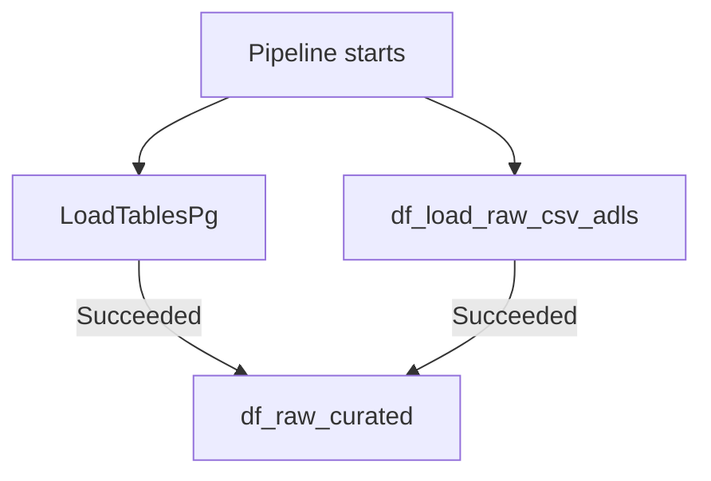

# DMC Azure Project 1 — Raw-to-curated pipeline

Azure Data Factory pipeline `pl_raw_curated_pr1` loads HR tables from PostgreSQL and employee commission data from CSV into the raw layer in ADLS Gen2. It then runs a Mapping Data Flow that reads the four raw datasets and writes the curated `final_commission` Parquet output.

## Execution order

| Pipeline activity | Referenced resource | Behavior |
| --- | --- | --- |
| `LoadTablesPg` | `pl_load_raw_pg_adls_pr1` | Runs the child pipeline once for each of `cargo`, `empleado`, and `departamento`. Up to two iterations run concurrently. Each iteration waits for its child pipeline to complete. |
| `df_load_raw_csv_adls` | `df_load_raw_csv_adls_pr1` | Ingests the employee commission CSV into the raw layer. Starts independently of the PostgreSQL branch. |
| `df_raw_curated` | `df_raw_curated_pr1` | Reads the raw HR and commission datasets and writes the curated output. Runs only after both ingestion branches succeed. |

## Parameters

The parent pipeline takes no runtime parameters. Each PostgreSQL child run receives `p_schema = rrhh`, `p_table = @item()`, and `p_layer = raw`.

| Data flow | Data flow source or sink | `p_layer` | `p_origin` | `p_entity` |
| --- | --- | --- | --- | --- |
| `df_load_raw_csv_adls_pr1` | `outputEmployeeCommission` | `raw` | `csv` | `employee_commission` |
| `df_raw_curated_pr1` | `Title` | `raw` | `rrhh` | `cargo` |
| `df_raw_curated_pr1` | `employee` | `raw` | `rrhh` | `empleado` |
| `df_raw_curated_pr1` | `department` | `raw` | `rrhh` | `departamento` |
| `df_raw_curated_pr1` | `commission` | `raw` | `csv` | `employee_commission` |
| `df_raw_curated_pr1` | `sink` | `curated` | `parquet` | `final_commission` |

The pipeline passes these dataset parameters by source or sink name. Each listed source or sink references the `ds_adls_parquet_pr1` dataset, which uses the parameters to resolve its ADLS Gen2 location.

## CSV to raw — `df_load_raw_csv_adls_pr1`

The `inputEmployeeCommission` source reads `ds_adls_landing_commission_csv`. The `select` transformation renames the three projected fields and keeps them as strings in the raw layer.

| CSV field | Raw Parquet field |
| --- | --- |
| `empleado_id` | `employee_id` |
| `Nombre y Apellido` | `full_name` |
| `Comisión` | `commission` |

The `outputEmployeeCommission` sink uses `ds_adls_parquet_pr1` and writes `employee_commission.parquet`.

## Raw to curated — `df_raw_curated_pr1`

All four sources and the curated sink use `ds_adls_parquet_pr1` with the bindings listed above.

- `cleanEmployee` converts `mnt_salario` and `mnt_tope_comision` from `decimal(38,18)` to `decimal(18,2)`. It builds `documento` as `tip_documento-num_documento` and `nombre_completo` as `nom_empleado-ape_empleado`.
- `cleanCommission` converts `employee_id` to integer and `commission` to `decimal(18,2)`.

| Order | Right-side stream | Left join key |
| --- | --- | --- |
| 1 | `department` | `employee@cod_departamento == department@cod_departamento` |
| 2 | `Title` | `employee@cod_cargo == Title@cod_cargo` |
| 3 | `cleanCommission` | `empleado_id == employee_id` |

The joins use exact matching and preserve employees without a match. Multiple commission rows for the same employee ID can produce multiple output rows for that employee.

| Field | Calculation |
| --- | --- |
| `tope_aplicable` | `least(mnt_salario, mnt_tope_comision)` |
| `mnt_comision_bruta` | `commission`, with null replaced by decimal zero |
| `mnt_comision_final` | Use `tope_aplicable` when gross commission exceeds it. Otherwise use gross commission. |
| `ind_tope_aplicado` | `SI` when gross commission exceeds the cap. Otherwise `NO`, including equality. |
| `mnt_total_pagar` | `mnt_salario + mnt_comision_final` |

The final `select` writes these columns in order to `final_commission.parquet`.

1. `empleado_id`
2. `documento`
3. `nombre_completo`
4. `des_departamento`
5. `des_cargo`
6. `mnt_salario`
7. `mnt_tope_comision`
8. `mnt_comision_bruta`
9. `mnt_comision_final`
10. `ind_tope_aplicado`
11. `mnt_total_pagar`

Both sinks use one hash partition, an explicit Parquet filename, and `truncate: true`. Verify the target paths before rerunning because the sinks can clear existing output. Both flows allow schema drift, disable schema validation, and require their source files to exist.

## Run and verify

1. Confirm that the referenced child pipeline and both Mapping Data Flows are deployed. Check that their linked services can read the PostgreSQL tables and the commission CSV and can access the required ADLS Gen2 locations.
2. In ADF Studio, open `pl_raw_curated_pr1` and choose **Add trigger → Trigger now**.
3. In **Monitor**, open the pipeline run and check that both ingestion activities succeeded. If `LoadTablesPg` fails, inspect the individual child pipeline runs to identify the affected table.
4. Confirm that `df_raw_curated` succeeded and that the `final_commission` Parquet output exists at the path resolved by the curated sink dataset.

Both Mapping Data Flow activities use **General** compute with **8 cores**, **Fine** tracing, a **12-hour** timeout, and **zero automatic retries**. Before rerunning a failed pipeline, check the sink write settings to see how each ingestion activity handles existing files.
