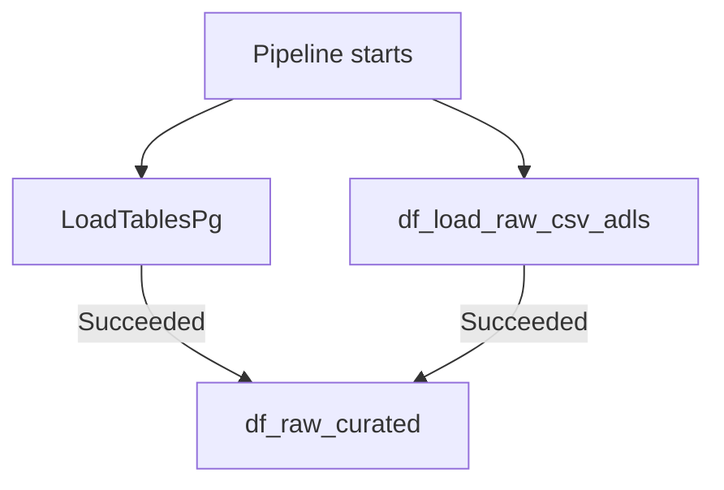

# DMC Azure Project 1 — Raw-to-curated pipeline

Azure Data Factory pipeline `pl_raw_curated_pr1` loads HR tables from PostgreSQL and employee commission data from CSV into the raw layer in ADLS Gen2. It then runs a Mapping Data Flow that reads the four raw datasets and writes the curated `final_commission` Parquet output.

## Execution order

| Pipeline activity | Referenced resource | Behavior |
| --- | --- | --- |
| `LoadTablesPg` | `pl_load_raw_pg_adls_pr1` | Runs the child pipeline once for each of `cargo`, `empleado`, and `departamento`. Up to two iterations run concurrently. Each iteration waits for its child pipeline to complete. |
| `df_load_raw_csv_adls` | `df_load_raw_csv_adls_pr1` | Ingests the employee commission CSV into the raw layer. Starts independently of the PostgreSQL branch. |
| `df_raw_curated` | `df_raw_curated_pr1` | Reads the raw HR and commission datasets and writes the curated output. Runs only after both ingestion branches succeed. |

## Parameters

The parent pipeline takes no runtime parameters. Each PostgreSQL child run receives `p_schema = rrhh`, `p_table = @item()`, and `p_layer = raw`.

| Data flow | Dataset binding | `p_layer` | `p_origin` | `p_entity` |
| --- | --- | --- | --- | --- |
| `df_load_raw_csv_adls_pr1` | `outputEmployeeCommission` | `raw` | `csv` | `employee_commission` |
| `df_raw_curated_pr1` | `Title` | `raw` | `rrhh` | `cargo` |
| `df_raw_curated_pr1` | `employee` | `raw` | `rrhh` | `empleado` |
| `df_raw_curated_pr1` | `department` | `raw` | `rrhh` | `departamento` |
| `df_raw_curated_pr1` | `commission` | `raw` | `csv` | `employee_commission` |
| `df_raw_curated_pr1` | `sink` | `curated` | `parquet` | `final_commission` |

The referenced datasets resolve the ADLS Gen2 paths from these parameters. The definition of `df_raw_curated_pr1` contains the joins, transformations, and output schema.

## Run and verify

1. Confirm that the referenced child pipeline and both Mapping Data Flows are deployed. Check that their linked services can read the PostgreSQL tables and the commission CSV and can access the required ADLS Gen2 locations.
2. In ADF Studio, open `pl_raw_curated_pr1` and choose **Add trigger → Trigger now**.
3. In **Monitor**, open the pipeline run and check that both ingestion activities succeeded. If `LoadTablesPg` fails, inspect the individual child pipeline runs to identify the affected table.
4. Confirm that `df_raw_curated` succeeded and that the `final_commission` Parquet output exists at the path resolved by the curated sink dataset.

Both Mapping Data Flow activities use **General** compute with **8 cores**, **Fine** tracing, a **12-hour** timeout, and **zero automatic retries**. Before rerunning a failed pipeline, check the sink write settings to see how each ingestion activity handles existing files.
